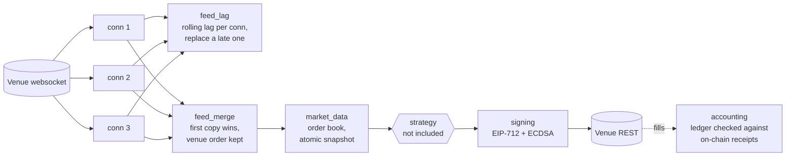

# polymarket-clob-infra

[](https://github.com/38st/polymarket-clob-infra/actions/workflows/ci.yml)
[](LICENSE)

Infrastructure from a Rust market maker I built for
[Polymarket](https://polymarket.com)'s central limit order book. This
repository holds the parts that are independent of any trading strategy: the
order book, the merge of redundant market-data connections, connection-lag
detection, EIP-712 order signing, and the execution ledger. Strategy, risk
rules, execution logic and research are not included.

## Architecture



## What's here

| Module | What it does |
|---|---|
| [`market_data`](src/market_data.rs) | One atomic snapshot of every subscribed book for each decision. Prices are integer millionths, exact for every tick size. Out-of-order and future-dated messages are refused. On a quiet market, books stay current only while the stream proves it is alive. |
| [`ws::feed_merge`](src/ws/feed_merge.rs) | Merges N websocket connections into one book per market. Each venue event is applied once, from whichever connection delivers it first, in the venue's order. A connection is "lined up" against a log of applied events by content key. If two connections disagree about the market's history, the market is rebuilt from a fresh snapshot. |
| [`ws::feed_lag`](src/ws/feed_lag.rs) | Delivery lag per connection over a rolling window (a histogram with quantiles), a check of the local clock against the venue's, and the rules that replace a connection that stays late. |
| [`polymarket::signing`](src/polymarket/signing.rs), [`abi`](src/abi.rs) | EIP-712 typed-data signing of CLOB orders with secp256k1, checked against the official Python SDK's test vectors. The key's bytes are zeroized on drop. |
| [`polymarket::auth`](src/polymarket/auth.rs) | L1 (EIP-712) and L2 (HMAC) API authentication. |
| [`accounting`](src/accounting.rs), [`receipts`](src/receipts.rs) | A durable record of executions and an average-cost portfolio built from it. A missing fee or settlement stays *unknown* and is never treated as zero. Fills are checked against the on-chain settlement receipts, and settled history is archived. |

## See it run

[`examples/replay.rs`](examples/replay.rs) replays 8 minutes of a recorded
market (36,815 venue messages) over three simulated connections. Each has its
own latency, jitter and slow spell, and one of them skips a book event:

```text
$ cargo run --release --example replay
connection 3 diverged from the applied history: dropped
36815 messages, 3 connections, 480 s of market
                 applied: 36815
      duplicates dropped: 70445
    held while lining up: 11
  connection 1 delivered first: 46.1%
  connection 2 delivered first: 36.9%
  connection 3 delivered first: 17.0%
  merged lead over connection 1 alone: mean 30.0 ms, p99 87.5 ms, max 106.7 ms
  merged lead over connection 2 alone: mean 5.5 ms, p99 122.1 ms, max 147.2 ms
  merged lead over connection 3 alone: mean 8.9 ms, p99 69.2 ms, max 116.4 ms
  merge cost: 1281 ns per delivered message
merged book == single-stream book on both tokens: OK
```

Every venue message is applied exactly once and every copy is dropped. The
connection that skipped an event is caught and dropped the moment its history
disagrees. The final book is identical to the one built from the venue's own
stream.

## Design notes and measurements

These come from the module docs, where each is explained in full.

- **Why redundant feeds.** Measured over 140 two-minute probe runs: median
  delivery lag was 10 ms, but p90 was 62-83 ms and p99 about 370 ms. 3.6% of
  connections were 75-87 ms late for their whole life. A single long-lived
  socket can sit 80 ms behind without knowing it.
- **Why merge by position.** Two recorders compared over 1.39 M common book
  events delivered them in the same order on every connection, with no swaps.
  Trade prints float against them (2,757 inversions), and the venue repeats
  single messages verbatim (1,105 in 6.5 M events, never three in a row). So
  book events are merged by their position in a shared log, prints are
  counted by copy, and a connection lines up only after 4 consecutive matches.
- **Clock-free comparison.** Comparing two connections' lags needs no clock,
  because the local clock's error cancels out. An absolute lag limit does need
  one, so it applies only while a clock check bounds the offset to about one
  round trip. The check works even though the venue reports whole seconds: it
  times its requests across the venue's second boundaries.
- **Exact money.** Fill and receipt checks work in on-chain integer units.
  The venue rounds each partial fill to whole units, so the tolerance is
  exactly one unit, not a float epsilon.
- **Fail closed.** An invalid setting is an error, never a silent default. A
  missing fee is unknown, never zero. Release builds keep integer-overflow
  checks on, and a test fails if they are ever turned off.

## Benchmarks

`cargo bench` (criterion), Apple M2 Max, release build:

| Operation | Cost |
|---|---|
| Apply a venue message to the book | 172 ns |
| Content key of a feed message | 0.72 µs |
| Merge a message (one connection, including its copy) | 2.9 µs |
| Sign an order (EIP-712 hash + ECDSA) | 51 µs |
| L2 HMAC request signature | 1.7 µs |

## Running

```bash
cargo test --release
cargo run --release --example replay
cargo bench
```

The tests replay every message of a recorded live market
(`tests/fixtures/recorded_market.jsonl.gz`, public venue data). Signing is
checked against the official SDK's vectors using the public test key `0x…01`.

## License

MIT
